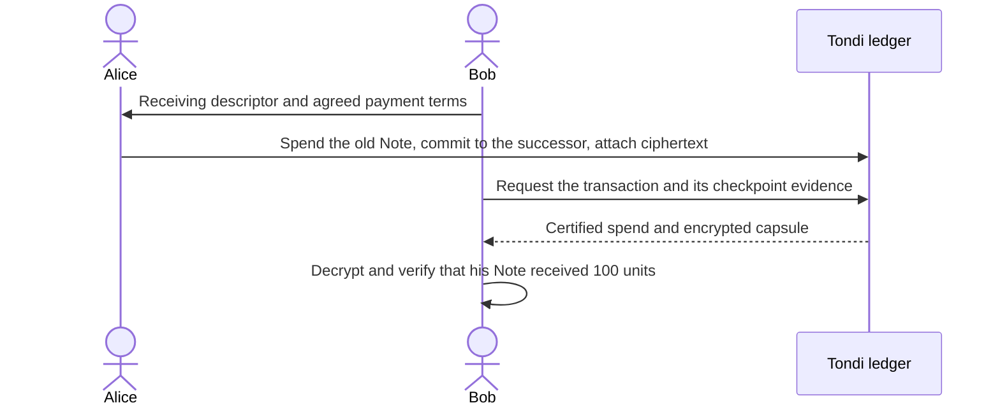
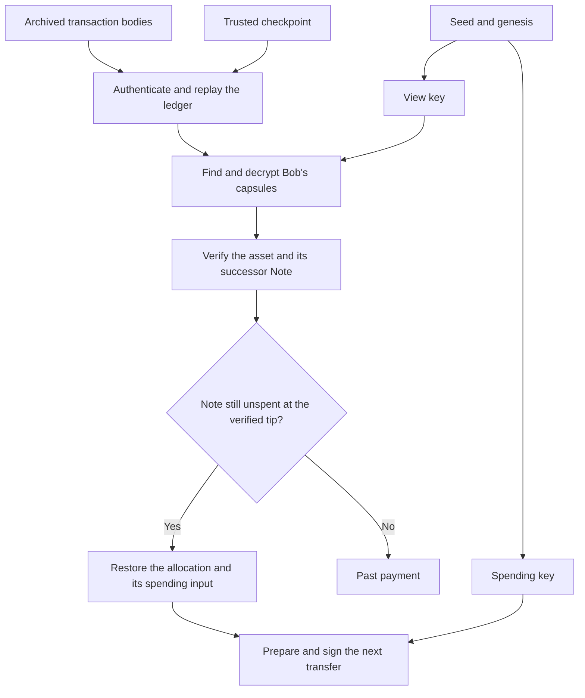

# Really Good Tondi (RGT)

Suppose Alice pays Bob 100 units of an asset. A year later Bob loses his wallet. Alice has gone offline. What must survive for Bob to pay Carol?

Bob's seed can reproduce his signing key. It cannot tell him which payment gave him the 100 units. RGT is a protocol for transferring assets on Tondi v10. Each payment carries the evidence its recipient will need to recover the asset and spend it again. Tondi settles which Note was spent. The recipient checks what happened to the asset.

## A payment

A Tondi Note is an output that can be spent once. Alice could give Bob and Carol two payment histories, each claiming the same 100 units. Both transfers would have to consume the same Note. At most one can be certified as a successful spend.

Alice's transaction commits to an asset operation. The operation identifies Bob's new Note by a hash that includes a secret random value. Bob receives the data needed to recompute that hash. He checks the contract, amount and destination against his invoice. Alice can spend her Note and omit a valid successor. In that case the ledger records a spend and the asset allocation is burned.

The ciphertext is a *recipient-encrypted capsule*. Alice combines a fresh ephemeral key with Bob's public view key using ECDH. From the shared secret she derives a one-time AES-256-GCM key. Bob can derive the same key and recover the private data. Observers can still see when the transaction occurred, how large the capsule is, and which payments use the same receiving authorization.

## How much history must Bob check?

The simplest capsule carries the history up to Alice's Note. Bob checks issuance and each transfer in turn. When he pays Carol, she has one more transfer to check. If every payment carries its predecessors, the history must eventually exceed the space in a transaction.

A recursive receipt lets the same work be carried forward. The first receipt proves issuance. To produce the next receipt, the prover verifies the preceding one, checks that the new transaction consumes the Note it named, and applies the contract rules to the successor. Bob can then check one receipt and the Tondi evidence for his own payment. This rule currently covers a single unlocked allocation transferred in full under unsigned issuing terms. Splits and merges need a different rule.

There is a reason Alice puts the **preceding** receipt in the capsule. The capsule is part of the transaction bytes that determine Bob's new transaction ID. Alice can already prove how she acquired her Note. Once her payment is certified, Bob has the final ID, the private opening and the exact transaction. He can fold that last step into a new receipt before paying Carol. [Protocol and proof formats](TONDI_MIGRATION.md)

## Recovery after a loss

Bob starts with his seed, the chain genesis and a recent checkpoint obtained independently. His wallet authenticates and replays the archived bodies from genesis. It uses the view key to find his capsules and checks which of the recovered Notes are still live. A payment to Bob remains a valid historical fact even after he has spent it. Only an unspent Note belongs in his recovered balance.

A checkpoint can authenticate bytes that an archive supplies. If every copy of the ciphertext has been pruned, the seed cannot reconstruct it. Bob needs at least one archive that still has the bodies. The independently obtained checkpoint also matters because an old, correctly signed view of the ledger can omit a later spend.

## What it costs

These are byte counts for the same two payments on a local, single-validator ledger. Each payment moved the whole 100-unit allocation. The two offline packages in each column certify the same delivery. Both were verified with the node offline.

| Bytes | Alice → Bob | Bob → Carol |
| --- | ---: | ---: |
| On-chain capsule carrying full history | 1,560 | 3,774 |
| Signed transaction including that capsule | 1,896 | 4,110 |
| Private transfer history | 3,066 | 7,494 |
| Full-history package with finality evidence | 14,686 | 37,751 |
| Recursive receipt alone | 278,738 | 278,738 |
| Recursive package with finality evidence | 300,265 | 318,522 |

For these two payments, the full history took fewer bytes. Recursion let Carol verify the earlier asset history with one receipt. Her package still grew because it also carried the terminal transaction and checkpoint evidence. The cost of producing the second receipt was 4,194,304 guest cycles.

A separate payment used a capsule carrying the predecessor receipt. The encrypted capsule occupied **227,300 bytes** of a **227,636-byte** signed transaction. Carol recovered the 100 units in an empty wallet. Executing the proof program on this recovered payment used **56,114,463 guest cycles**. The native limit is 524,288 bytes for the entire transaction.

Measurement details

The first two transfers were certified at checkpoints 4 and 8. The independently supplied genesis manifest was 21,876 bytes. With gzip, the full-history packages were 7,789 and 19,591 bytes. The recursive packages were 255,363 and 258,557 bytes. The second receipt took 703 seconds to prove on the test CPU while another prover was running.

Bob's first verified wallet snapshot was 226,593 bytes. Snapshots use fixed-width encoding for proof words. Recursive delivery files use variable-length encoding. In the separate payment, Bob started with a 226,592-byte snapshot. At checkpoint 8 Carol recovered a 682,379-byte local file containing the previous snapshot and the current body.

To repeat the two-hop transfer and seed recovery, place the Tondi v10 checkout at `../Tondi` and run `python3 scripts/v10_transfer_local.py target/rgt-run` with a fresh output directory. [Wallet walkthrough](QUICK_START.md) · [Reproduce the recursive proofs](WORKSPACE_SETUP.md#recursive-proof)
