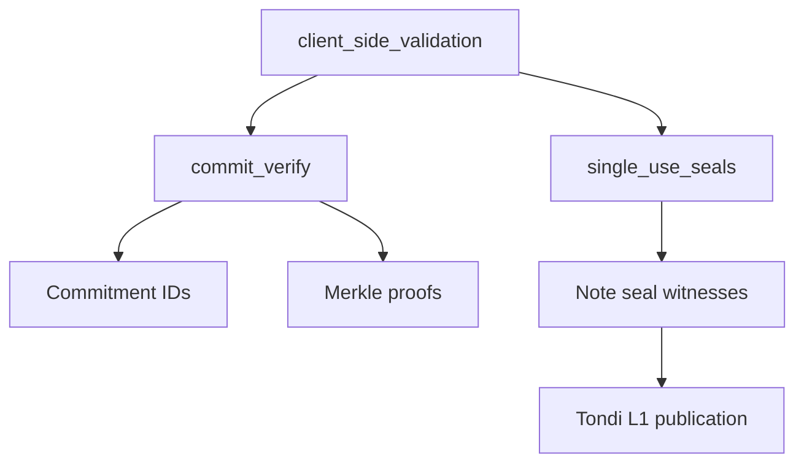

# Client-side Validation for Tondi

This workspace subtree contains the generic client-side validation primitives
used by RGT. The crates here define deterministic commitments,
single-use seal traits, and the verification logic for private transfer histories.

## Components



- `commit_verify` provides commitment identifiers, multi-message commitments,
  tagged merkle structures, and deterministic digest helpers.
- `single_use_seals` defines the seal traits used by Tondi transaction outputs.
- `client_side_validation` re-exports the pieces needed by contract validation
  code.

## Production Position

RGT closes Note seals with signed Telegraph envelopes and verifies the matching checkpoint evidence.

## Usage

Use the workspace crates directly:

```toml
client_side_validation = { workspace = true }
commit_verify = { workspace = true }
single_use_seals = { workspace = true }
```

Feature flags are intentionally narrow:

- `rand` enables random 32-byte values used in tests and protocol helpers.
- `serde` enables structured serialization for application-facing data.

## Testing

From the repository root:

```bash
cargo test -p client_side_validation
cargo test -p commit_verify
cargo test -p single_use_seals
```

Any new seal implementation must include deterministic positive and negative
verification tests, including mismatched message and already-spent cases.
