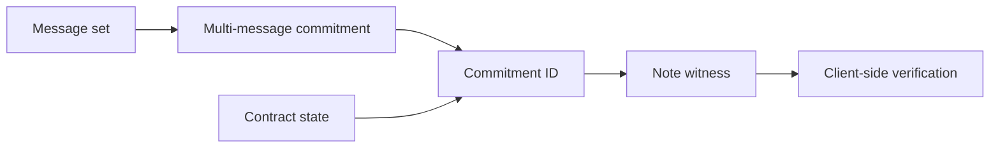

# Commit Verify for Tondi

`commit_verify` provides the deterministic commitment primitives used by
RGT contracts and seal witnesses.

## Responsibilities



The crate owns:

- commitment identifiers;
- tagged merkle structures;
- multi-message commitment proofs;
- deterministic digest helpers for Tondi-facing validation code.

## Usage

```toml
commit_verify = { workspace = true }
```

Prefer deriving or implementing the workspace commitment traits instead of
serializing ad hoc byte strings. Commitment inputs must be stable across
platforms and must not depend on host ordering.

## Feature Flags

- `rand` enables random test values and helper generation.
- `serde` enables application-facing serialization.

## Testing

```bash
cargo test -p commit_verify
```

Add tests for every new commitment encoding and every verifier branch that can
reject a malformed proof.
