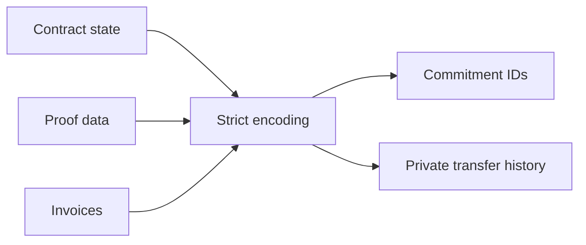

# Strict Encoding for Tondi

Deterministic binary serialization for RGT client-side validation.

This crate provides the `StrictEncode` and `StrictDecode` traits used by Tondi
contract state, seals, proofs, invoices, and transport payloads. The encoding is
schema-driven, platform-independent, and stable across Rust targets, including
native node tooling and wallet-side workflows.

## Where It Fits



## Usage

Add the local workspace crate through the RGT workspace dependency
table.

```toml
strict_encoding = { workspace = true }
```

Types that cross consensus, storage, or wallet transport boundaries should derive
both traits:

```rust
use strict_encoding::{StrictDecode, StrictEncode};

#[derive(StrictEncode, StrictDecode)]
pub struct TransferMemo {
    pub contract: [u8; 32],
    pub amount: u64,
}
```

## Feature Notes

- `derive` enables the derive macros.
- Optional integrations are kept behind features so production wallets can keep
  their dependency surface small.
- Tondi-facing formats use BLAKE3-oriented commitment code from this workspace
  rather than upstream chain encodings.

## Development

Run crate tests from the repository root:

```bash
cargo test -p strict_encoding
```

Keep changes deterministic and avoid adding serialization behavior that depends
on host architecture, locale, time zone, or map iteration order.
